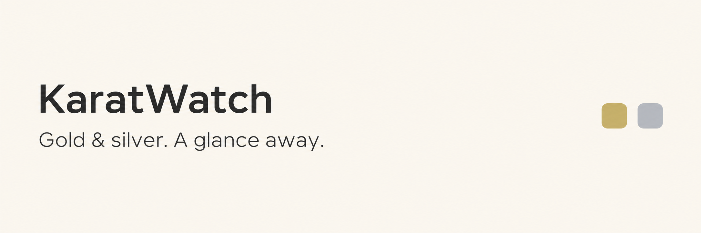
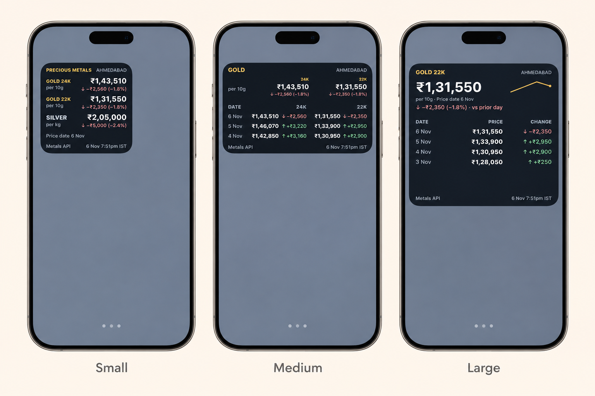

<div align="center">

# KaratWatch
### Gold & silver. A glance away.

A Scriptable widget for your iPhone Home Screen — current prices, history, and alerts for your city.

[](https://github.com/m4d4g4sk4r/karatwatch/actions/workflows/ci.yml)

[**Get the widget**](frontend/KaratWatch.js) · [Setup](#on-your-home-screen) · [Optional backend](backend/README.md) · [Contribute](CONTRIBUTING.md)

</div>



## KaratWatch on iPhone



*Illustrative iPhone Home Screen previews; prices shown are historical.*

---

## Your metals, your view

- **Today at a glance:** 24K gold, 22K gold, and silver with clearly labelled units.
- **Look back:** dated history, price changes, and compact charts in small, medium, and large widgets.
- **Make it yours:** light/dark appearance, configurable history length, and price alerts.
- **Keep useful data:** validated local caching with visible offline and stale states.
- **Start without a server:** the widget fetches Goodreturns directly. No API credentials are required in the default mode.

Gold is shown in INR per **10 grams**, silver per **kilogram**. Prices are indicative source rates, not guaranteed transaction quotes.

## On your Home Screen

1. Install **Scriptable** on your iPhone.
2. Open [KaratWatch.js](frontend/KaratWatch.js), select **Raw**, and copy the script into a new Scriptable script named **KaratWatch**.
3. Run the script in Scriptable. Choose **Refresh prices now**, then preview your widget.
4. Add a Scriptable widget to your Home Screen, edit it, and choose KaratWatch.
5. Enter one of the parameters below. Leave it empty for today’s prices.

No backend setup is needed. `SETTINGS.serverURL` is empty by default.

**Choose your city:** run the script and select **Change city**. Ahmedabad is the
initial default. The picker loads the Indian cities table from the
[Goodreturns gold directory](https://www.goodreturns.in/gold-rates/), with a saved
list available offline. You can also enter a city slug manually, such as `mumbai`,
`chennai`, or `bangalore` (`Bengaluru` also works). The city must have both gold and
silver pages with the supported table format; unavailable pages show a fetch error.
The saved choice applies to all widgets using this installation. Prices, retry
state, and alert thresholds are stored separately for each city. Existing Ahmedabad
cache and alert files are preserved. Widget parameters such as `gold:7` are unchanged.

In optional API mode, the response’s `city` must match the selected city. The widget sends the selected slug as a `city` query parameter,
for example `/api/metals?city=mumbai`. The included backend isolates prices and
provider state by city. A mismatched response is rejected.

| Parameter | What you see |
| --- | --- |
| `today` | Gold 24K, gold 22K, and silver |
| `gold` | Both gold purities and history |
| `gold:7` | Both gold purities, seven history rows |
| `gold:24k` | Only 24K gold |
| `gold:22k:7` | Only 22K gold, seven history rows |
| `silver` / `silver:7` | Silver history |

History length supports 2–10 rows. Consecutive unchanged prices may share a displayed row.
The default refresh schedule is 05:00 in the phone’s local timezone; iOS determines
actual execution times. Tap to refresh or use the in-app menu. Alerts run when the
script executes, not as an always-on background monitor.

## Two ways to get prices

**Direct — default.** Your phone requests your selected city’s gold and silver pages,
parses their price tables, validates the result, and saves a local cache. No account
or credentials. Site blocking, unavailable pages, or layout changes can interrupt
updates; the widget shows cached data where available. It does not bypass challenges.

**Your API — optional.** Set `SETTINGS.serverURL` to a compatible `/api/metals`
endpoint and configure its credentials in the in-app menu. The included
[FastAPI backend](backend/README.md) adds shared caching, provider extensibility,
failover machinery, and rate limits. You do not need to deploy it to use the widget.
In API mode, requests use all three configured headers; failures use local cache.
Switching modes does not automatically change your installed personal script.

## For developers

KaratWatch lives in [`frontend/KaratWatch.js`](frontend/KaratWatch.js).
The backend is an optional supporting component in `backend/`.

```bash
# Widget behavior tests — no npm dependencies
node --test frontend/tests/*.test.cjs
# Syntax validation (Scriptable supports top-level await)
node --input-type=module --check < frontend/KaratWatch.js
# Optional backend tests, after installing backend/requirements.txt
cd backend
python -m pytest tests -v
```

Every PR runs widget tests and syntax checks, Python 3.11/3.12 tests and compilation,
Gitleaks history scanning, publication checks, and Docker build/startup verification.
CI never deploys or needs production credentials. Node tests exercise parsing and
validation; they do not emulate Scriptable WebView or verify iPhone rendering.
See [CONTRIBUTING.md](CONTRIBUTING.md).

## Status and privacy

City selection is supported in direct and optional API modes. Automated tests cover
parsing, city isolation, and API behavior; visual layouts still need on-device review.

Credentials belong in Keychain or ignored `.env` files. Historical credentials were
rotated and repository history cleaned. Re-clone old checkouts rather than merging old history. Cached GitHub views or downloaded copies can retain revoked values.
The ignored personal widget is never published.

## License

KaratWatch is available under the [MIT License](LICENSE), including its warranty
and liability disclaimers. Keep the copyright and license notice when redistributing
copies or substantial portions of the software.

Prices are third-party, indicative data; this software license does not grant rights
to Goodreturns content or change its terms. See the license for the full terms.
